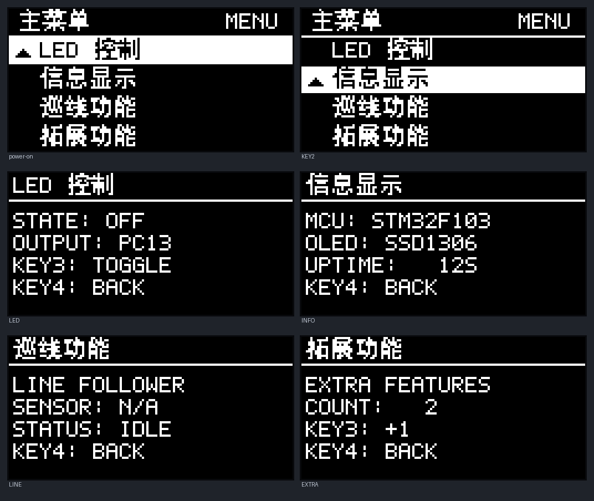
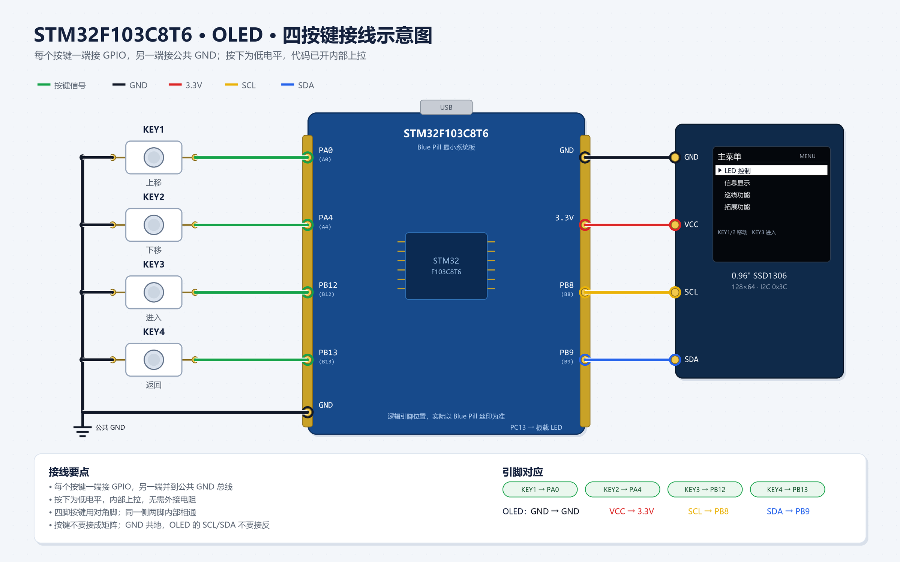
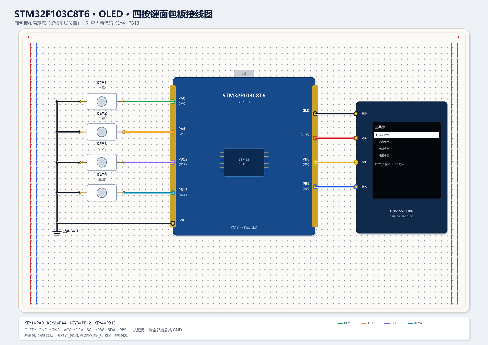
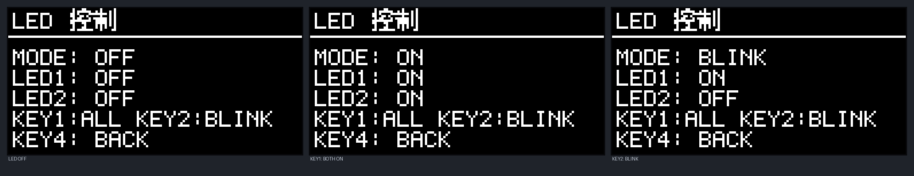
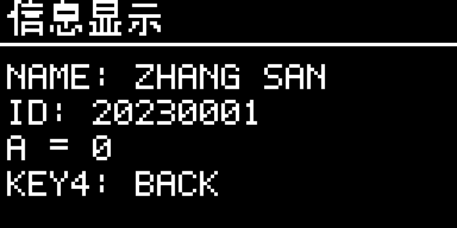

# OLED 多级菜单 / LED / 串口通信实现指南



上图是用**最终 C 代码实际生成的 128×64 显存**导出的效果，不是手绘示意图。左上为上电主菜单，右上为按 KEY2 后箭头移到第二行；下面四张是四个子菜单。

---

## 1. 先明确得分点

| 评分点 | 代码中的实现 | 验证方法 |
|---|---|---|
| 上电显示主菜单 | `Menu_Init()` 设置 `PAGE_MAIN`，`main()` 中立即 `Menu_Refresh()` | 复位后第一眼即主菜单 |
| 默认箭头指向首行 | `s_cursor = 0` | 上电时第一行反白并有三角形箭头 |
| KEY1/KEY2 移动箭头 | `Menu_HandleKey()` 中 KEY1 上移、KEY2 下移，首尾循环 | 连续按 KEY2 可到第 4 行，再按回到第 1 行 |
| 至少四个菜单项 | `LED 控制`、`信息显示`、`巡线功能`、`拓展功能` | 主菜单四行完整显示 |
| KEY3 进入当前子菜单 | 主菜单状态下 `s_page = s_items[s_cursor].page` | 光标在哪一行就进哪个页面 |
| KEY4 返回主菜单 | 所有子页面统一处理 `if (key == KEY4) s_page = PAGE_MAIN` | 任意子菜单按 KEY4 都回主菜单，且光标位置保留 |

> 关键点：**进入子菜单和返回子菜单都只由“按下沿”触发一次**。按住 KEY3 不会连续进入，按住 KEY4 也不会连续返回。

---

## 2. 硬件连接（默认方案）

代码按 STM32F103C8T6 最小系统板 + 0.96 寸 SSD1306 I2C OLED + 四个独立按键编写。

| 器件 | 引脚 | 说明 |
|---|---|---|
| OLED VCC | 3.3V | 不要接 5V |
| OLED GND | GND | 共地 |
| OLED SCL | PB8 | 软件 I2C |
| OLED SDA | PB9 | 软件 I2C |
| KEY1 | PA0 → GND | 内部上拉，按下为低 |
| KEY2 | PA4 → GND | 内部上拉，按下为低 |
| KEY3 | PB12 → GND | 内部上拉，按下为低 |
| KEY4 | PB13 → GND | 内部上拉，按下为低 |
| LED1 | PC13 | 板载 LED，低电平点亮 |
| LED2 | PA1 | 外部 LED，高电平点亮：PA1 → 330Ω → LED → GND |
| USB-TTL RXD | PA9（USART1_TX） | 交叉连接：模块 RXD 接 PA9 |
| USB-TTL TXD | PA10（USART1_RX） | 交叉连接：模块 TXD 接 PA10 |
| USB-TTL GND | GND | 必须共地 |

注意事项：

- OLED 模块一般自带上拉电阻；如果你的模块没有，SCL/SDA 各接一个 4.7kΩ 到 3.3V。
- 按键一端接引脚、另一端接 GND，**不需要外部上拉**，代码里开了内部上拉。
- 如果你的按键是“按下为高”，把 `BoardConfig.h` 里的 `KEY_ACTIVE_LEVEL` 改成 `1`。
- 如果 OLED 的 I2C 地址是 0x3D，把 `OLED_I2C_ADDRESS` 从 `0x78` 改成 `0x7A`。
- LED1 默认用板载 PC13（低电平点亮）；LED2 默认接 PA1（高电平点亮：PA1 → 330Ω → LED 阳极，LED 阴极 → GND）。如果你的两个 LED 在别的引脚或有效电平不同，改 `BoardConfig.h` 的 `LED1_*`、`LED2_*` 宏。
- 串口是 **3.3V TTL 电平**，不是 RS-232；不要直接把 DB9 串口接到 PA9/PA10，否则可能烧引脚。
- 姓名和学号在 `BoardConfig.h` 的 `INFO_NAME`、`INFO_STUDENT_ID` 里改，默认是占位值 `ZHANG SAN` / `20230001`。

所有引脚都集中在 **`Hardware/BoardConfig.h`**，移植时只改这一个文件。



> 上图是逻辑接线图，重点看“每个按键一端接 GPIO、另一端接公共 GND”。Blue Pill 上 PA0/A0、PA4/A4 等是同一个引脚的不同丝印写法，实际插线时以板子上的丝印为准。



> 面包板图是按当前代码画的：KEY1=PA0、KEY2=PA4、KEY3=PB12、KEY4=PB13。图中为了看清走线，把 Blue Pill 用到的引脚画在左右两侧；实际板子的排针在上下两边，接线时按 PA0/A0、PB13/B13 等丝印对应即可。

---

## 3. 文件结构

```text
STM32_LED/
├─ User/
│  ├─ main.c              ← 初始化 + 10 ms 主循环
│  ├─ menu.c              ← 菜单状态机、四个页面绘制
│  └─ menu.h
├─ Hardware/
│  ├─ BoardConfig.h       ← 所有引脚、有效电平、I2C 地址
│  ├─ OLED.c / OLED.h     ← SSD1306 软件 I2C 驱动 + 1KB 显存
│  ├─ OLED_Font.c / .h    ← 5×7 ASCII + 11×11 中文点阵
│  ├─ Key.c / Key.h       ← 四键扫描 + 消抖 + 按下沿
│  ├─ LED.c / LED.h       ← 双 LED 常亮/常灭/交替闪烁
│  └─ UART.c / UART.h     ← USART1 中断收行、变量 a 解析/回复
├─ System/
│  └─ Delay.c / Delay.h   ← 江协科技教程配套延时（需自行加入工程）
├─ tools/
│  ├─ gen_font.py         ← 重新生成中文字模
│  ├─ preview_menu.py     ← 生成菜单效果预览图
│  ├─ draw_wiring.py      ← 生成按键/OLED 逻辑接线图
│  └─ draw_breadboard.py  ← 生成面包板布局接线图
└─ tests/
   ├─ test_menu.c         ← 主机端状态机测试
   ├─ test_key.c          ← 按键消抖/单次触发测试
   └─ dump_screens.c      ← 导出真实 C 显存做视觉检查
```

设计上的两个取舍：

1. **C 源文件里不写中文字符串**。菜单的中文用字模编号（`CN_KONG`、`CN_ZHI`…）表示，避免 Keil 工程源文件编码（GB2312/UTF-8）不一致导致乱码或编译报错。
2. **使用 1KB 显存 + 整屏刷新**。每次先把画面画到 `s_gram[8][128]`，再一次性写 OLED。这样不会闪烁，也不会出现“改一个数字留下残影”的问题。

---

## 4. Keil5 工程配置

### 4.1 加入源文件

在 Keil 工程中新建分组 `Hardware`，加入：

```text
Hardware/OLED.c
Hardware/OLED_Font.c
Hardware/Key.c
Hardware/LED.c
Hardware/UART.c
```

在 `User` 分组加入：

```text
User/main.c
User/menu.c
```

> `Hardware/OLED_Font.c` 必须加入，否则链接会报 `OLED_Font6x8`、`OLED_Font11x11` 未定义。

> **不要把 `tools/`、`docs/`、`tests/` 里的 `.py`、`.png`、`.json`、`.md`、`.exe` 加入 Keil 工程。** Keil 会把它们当成 Image File 调用 FCARM，出现 `FCARM - Output Name not specified`，导致 `Target not created`。这些文件只用于电脑端生成字模、预览图和测试，不属于单片机工程。

> `UART.c` 里实现了 `USART1_IRQHandler`。如果你的 `stm32f10x_it.c` 里已经有一个空的 `USART1_IRQHandler`，请把它删掉或注释，否则链接会报重复定义。

### 4.2 Include Paths

在 `Options for Target → C/C++ → Include Paths` 中加入：

```text
User
Hardware
System
Library/inc          （标准外设库）
Start                （按你的工程实际目录）
```

### 4.3 宏定义与编译选项

`Options for Target → C/C++ → Define`：

```text
STM32F10X_MD,USE_STDPERIPH_DRIVER
```

勾选 **C99 Mode**，勾选 **Use MicroLIB**（与原有 LED 工程保持一致即可）。

同时检查 `Options for Target → Output → Name of Executable`，不能为空，建议填 `STM32_OLED`，并勾选 `Create HEX File`。

### 4.4 必须有 Delay.c

本工程调用 `Delay_ms()` 和 `Delay_us()`。如果你还没有加入江协科技教程的 `System/Delay.c / Delay.h`，请从教程资料中复制进来并加入 `System` 分组。

- `Delay_ms()` 用于上电等待 OLED 稳定、主循环 10 ms 节拍。
- `Delay_us()` 用于软件 I2C 的位延时。

如果你用的是别的延时库，只要保证这两个函数存在且参数是微秒/毫秒即可。

### 4.5 编译下载

Rebuild → 0 Error → Load。复位后应直接看到主菜单。

---

## 5. 程序是怎么工作的

### 5.1 主循环

`User/main.c`：

```c
OLED_Init();
Key_Init();
LED_Init();
UART_Init();
Menu_Init();
Menu_Refresh();          /* 上电立即显示主菜单 */

while (1) {
    KeyCode key = Key_Scan();

    UART_Process();       /* 解析串口收到的整行命令 */

    if (key != KEY_NONE) {
        Menu_HandleKey(key);
    }
    Menu_Tick();          /* 10 ms tick：LED 闪烁 + 变量 a 变化检测 */
    Menu_Refresh();       /* 只有 dirty 时才真正刷屏 */
    Delay_ms(10);
}
```

`Menu_Refresh()` 内部有 `s_dirty` 标志：没有按键、没有页面变化时不会重复刷屏，所以主循环不会被 OLED 刷新长期阻塞。

### 5.2 按键扫描

`Key_Scan()` 每 10 ms 调用一次，对每个按键做“连续 3 次相同电平才确认”的消抖。返回值只在**按下沿**产生一次：

```c
if (down != stable) {
    if (++counter >= 3) {
        stable = down;
        if (down) event = key;   /* 只在按下时返回 */
    }
} else {
    counter = 0;
}
```

这样按住 KEY1 不会让光标一直跑，按住 KEY3 也不会连续进入子菜单。

### 5.3 菜单状态机

只有两个核心变量：

```c
static MenuPage s_page;   /* 当前页面 */
static uint8_t  s_cursor; /* 主菜单当前行 0..3 */
```

主菜单按键逻辑：

| 按键 | 动作 |
|---|---|
| KEY1 | `cursor = (cursor + 3) % 4`，上移，首行再按跳到末行 |
| KEY2 | `cursor = (cursor + 1) % 4`，下移，末行再按跳到首行 |
| KEY3 | `page = items[cursor].page`，进入对应子菜单 |
| KEY4 | 主菜单下不处理 |

子菜单按键逻辑：

| 页面 | KEY1 | KEY2 | KEY3 | KEY4 |
|---|---|---|---|---|
| LED 控制 | 两灯全亮 ↔ 全灭 | 两灯交替闪烁 | 无 | 两灯全灭 + 返回主菜单 |
| 信息显示 | 无 | 无 | 无 | 返回主菜单 |
| 巡线功能 | 无 | 无 | 预留 | 返回主菜单 |
| 拓展功能 | 无 | 无 | 计数器 +1 | 返回主菜单 |

LED 页的 KEY1 逻辑是“当前不是全亮就全亮，当前全亮就全灭”，所以从闪烁状态按 KEY1 也会先变成两灯全亮，再按一次全灭。KEY2 进入交替闪烁时立即令 LED1 亮、LED2 灭，之后每 500 ms 交换一次，任何时刻都不会两灯同时亮或同时灭。

返回主菜单时 `s_cursor` 不重置，所以“从第三项进入再返回”仍然停在第三项，符合常见菜单习惯。

### 5.4 信息页与串口协议

信息页固定显示四行：

```text
NAME: ZHANG SAN
ID:   20230001
A =   0
KEY4: BACK
```

姓名和学号来自 `BoardConfig.h`：

```c
#define INFO_NAME        "ZHANG SAN"
#define INFO_STUDENT_ID  "20230001"
```

**请把这两个字符串改成你自己的拼音姓名和学号**，否则这一项会按占位内容显示。

串口使用 USART1：

```text
PA9  → USART1_TX
PA10 → USART1_RX
115200, 8 data bits, 1 stop bit, no parity
```

USB-TTL 模块与板子交叉连接：

```text
模块 RXD → PA9
模块 TXD → PA10
模块 GND → GND
```

协议：

| 上位机发送 | 单片机动作 |
|---|---|
| `111\r\n` | 令变量 `a = 111`，不回复 |
| `0\r\n` | 令变量 `a = 0` |
| `-25\r\n` | 令变量 `a = -25` |
| `GET A\r\n` | 回复当前值，例如 `111\r\n` |

`GET A` 大小写不敏感，`get a` 也可以；数字前后的空格会被忽略。收到完整一行（`\r` 或 `\n`）后，主循环调用 `UART_Process()` 解析，更新 `a` 并置 dirty，信息页下一次刷新就会显示新值。

`UART.c` 用 RXNE 中断收字符，主循环负责解析和回复，避免在中断里做耗时操作。`GET A` 的回复是十进制 ASCII 加 `\r\n`，支持 0、正数、负数。

### 5.5 页面绘制

每个页面一个 `Menu_DrawXxx()` 函数，流程统一：

```c
OLED_Clear();
Menu_DrawTitle(...);
OLED_ShowString(...);
OLED_ShowChinese11String(...);
OLED_Refresh();
```

主菜单每行 13 px：

```c
y = 13 + i * 13;
if (selected) {
    OLED_FillRect(0, y, 128, 12, 1);   /* 反白 */
    OLED_DrawArrow(3, y + 2, 0);       /* 黑色三角箭头 */
}
OLED_ShowString(14, y + 2, prefix, color);
OLED_ShowChinese11String(x, y, chinese, color);
```

- 未选中行：黑底白字，不画箭头。
- 选中行：白色横条 + 黑色文字 + 黑色三角形箭头。
- 箭头不是字符 `>`，而是 7×7 实心三角形，在 0.96 寸屏上更清楚。

### 5.5 中文显示

`OLED_Font.c` 里有两套字模：

- `OLED_Font6x8[95][6]`：ASCII 5×7，放在 6×8 格子里，用于所有英文/数字。
- `OLED_Font11x11[15][22]`：11×11 中文，只包含菜单需要的 15 个字：

```text
主 菜 单 控 制 信 息 显 示 巡 线 功 能 拓 展
```

菜单标签通过编号组合，例如：

```c
static const uint8_t s_led_cn[]   = {CN_KONG, CN_ZHI, CN_END};             /* 控制 */
static const uint8_t s_info_cn[]  = {CN_XIN, CN_XI, CN_XIAN_SHI, CN_SHI, CN_END}; /* 信息显示 */
```

如果以后要加字，修改 `tools/gen_font.py` 里的 `CN_CHARS`，运行：

```powershell
python tools/gen_font.py
python tools/preview_menu.py
```

会重新生成 `OLED_Font.c/.h` 和预览图。**不要手工改字模数组。**

---

## 6. 实测步骤（按评分点逐条走）

1. **上电**：屏幕出现“主菜单 / MENU”，四行分别是 `LED 控制`、`信息显示`、`巡线功能`、`拓展功能`；第一行反白，左侧有箭头。
2. **按 KEY2**：箭头移到第二行“信息显示”；再按 KEY2 到第三、第四行；在第四行再按 KEY2 回到第一行。
3. **按 KEY1**：箭头向上移动；在第一行按 KEY1 跳到第四行（首尾循环）。
4. **进入子菜单**：把箭头移到“LED 控制”，按 KEY3，出现 `LED 控制` 页面；按 KEY4 回到主菜单，箭头仍在“LED 控制”。
5. **其余子菜单**：分别选中“信息显示”“巡线功能”“拓展功能”，按 KEY3 进入，按 KEY4 返回。
6. **LED 控制页（对应 LED 部分 a~d）**：
   - 进入 `LED 控制`，初始 `MODE: OFF`，`LED1: OFF`，`LED2: OFF`。
   - 按 KEY1：两个 LED 同时亮，OLED 变为 `LED1: ON / LED2: ON`；再按 KEY1：两个 LED 同时灭。
   - 按 KEY2：两个 LED 开始交替闪烁，OLED 的 `LED1/LED2` 每 500 ms 交换一次，任何时刻都是一亮一灭。
   - 按 KEY4：两个 LED 立即熄灭，并返回主菜单。
7. **信息显示页（对应第 3 题 a）**：
   - 进入 `信息显示`，应看到 `NAME: 你的拼音`、`ID: 你的学号`、`A = 0`。
   - 上电后变量 `a` 的初始值必须是 0。
8. **串口修改变量（对应第 3 题 b）**：
   - USB-TTL 设为 `115200, 8N1`，发送 `111` 并加回车/换行。
   - OLED 信息页的 `A` 应变为 `111`。
   - 再发送 `-25`，应变为 `-25`。
9. **串口读取变量（对应第 3 题 c）**：
   - 发送 `GET A`，串口助手应收到当前值，例如 `111`。
   - 依次测试 `0`、正数、负数，每次发送 `GET A` 的返回值都应和 OLED 当前显示一致。
10. **拓展页**：按 KEY3 计数递增，按 KEY4 返回。

LED 状态在每次变化后由 `Menu_Tick()` 置 `dirty`，下一次 `Menu_Refresh()` 立即重画，因此从按键到 OLED 更新远小于 1 秒。





如果老师只考 a、b 两项，做到第 5 步就已经覆盖全部 6 分；第 6 步是 LED 部分 a~d 的实现与验证，第 7~9 步是第 3 题的实现与验证。

---

## 7. 常见问题排查

### OLED 完全不亮

按顺序检查：

1. VCC 是否 3.3V，GND 是否共地。
2. SCL/SDA 是否接反（PB8=SCL，PB9=SDA）。
3. 模块地址：大部分是 0x3C（代码 `0x78`），少数是 0x3D（改成 `0x7A`）。
4. 模块是否有上拉电阻；没有就加 4.7kΩ 到 3.3V。
5. 是否加入了 `OLED_Font.c`；如果只加 `OLED.c`，链接会失败，不会走到显示。
6. 如果屏幕有微弱亮光但无内容，检查 `OLED_Init()` 是否执行了 `Delay_ms(100)`，以及 `OLED_Refresh()` 是否被调用。

### 按键没有反应

1. 用万用表确认按键按下时引脚确实到 GND。
2. 确认 `BoardConfig.h` 的引脚和实际接线一致。
3. 如果是“按下为高”的模块，把 `KEY_ACTIVE_LEVEL` 改为 `1`。
4. 不要在 `while(1)` 里加 `Delay_ms(500)` 之类的长延时；按键扫描依赖 10 ms 节拍。
5. 如果按键引脚同时被其他外设占用（例如 PA0 接了别的东西），换到空闲引脚并改 `BoardConfig.h`。

### 串口收不到或显示乱码

1. USB-TTL 的 **TXD 接 PA10，RXD 接 PA9**，不要接反。
2. 模块 GND 必须和 Blue Pill GND 共地。
3. 串口助手设置为 **115200、8 数据位、1 停止位、无校验**。
4. 发送时要带回车/换行（`\r\n` 或 `\n`），否则 `UART_Process()` 不会处理这一行。
5. 确认 Keil 工程加入了 `Hardware/UART.c`，并且 `stm32f10x_it.c` 里没有重复的 `USART1_IRQHandler`。
6. `GET A` 必须带空格；大小写都可以。
7. 如果收到的是乱码，检查 USB-TTL 是否是 3.3V 电平、波特率是否一致。

### 中文显示乱码或编译报错

本工程 C 文件里**没有中文字符串**，正常不会出现编码问题。如果你自己往 `menu.c` 里加了中文，请改回字模编号，或者把 Keil 编辑器的编码统一为 UTF-8。

### 屏幕刷新很慢 / 按键迟钝

软件 I2C 的位延时在 `OLED.c` 的 `I2C_Delay()`：

```c
static void I2C_Delay(void) {
    Delay_us(1);
}
```

- 如果 OLED 不稳定，改成 `Delay_us(2)`。
- 如果希望更快，可改成 `Delay_us(1)` 并确认模块支持 400 kHz；不要低于 1 µs，否则 SSD1306 可能不响应。
- 整屏 1024 字节，400 kHz 下约 25 ms 刷完，正常按键不会觉得卡。

### 想改成“到顶不循环”

把 `Menu_HandleKey()` 中的两行改成边界判断即可：

```c
if (key == KEY1 && s_cursor > 0) s_cursor--;
if (key == KEY2 && s_cursor < MENU_ITEM_COUNT - 1) s_cursor++;
```

循环和夹紧都符合“按键能够正确移动箭头”的要求，按自己的习惯选一种。

---

## 8. 后续题目怎么接

### 巡线功能

`PAGE_LINE` 目前是占位页面。后续可以：

1. 新建 `Line.c/.h`，初始化灰度传感器/红外对管。
2. 在 `main()` 主循环中调用非阻塞的 `Line_Task()`。
3. 在 `Menu_DrawLine()` 中把 `SENSOR: N/A` 换成实际传感器状态，例如：

```c
OLED_ShowString(2, 28, "S1:", 1);
OLED_ShowString(26, 28, Line_Read(0) ? "1" : "0", 1);
```

4. 进入巡线页面时启动巡线，按 KEY4 返回时停止电机。注意：**不要在主循环里写死等**，否则 KEY4 会失灵。

### 拓展功能

`PAGE_EXTRA` 的计数器只是一个示例，证明子菜单内可以执行自己的逻辑。可以替换成蜂鸣器、舵机、温湿度等任意功能。

### 增加菜单项

在 `s_items[]` 中加一行，并补一个 `MenuPage` 和对应的 `Menu_DrawXxx()`。当前布局一屏正好 4 行；如果超过 4 项，需要加“窗口滚动”（只显示光标附近的 4 项），否则会画出屏幕。试题只要求 4 项，建议保持 4 项最稳。

---

## 9. 已验证内容

本仓库中做了四层验证：

1. **主机端状态机测试**：用 `gcc` 编译 `menu.c`、`OLED.c`、`Key.c`、`LED.c`（替换 STM32 头文件为测试桩），自动检查上电光标、上下移动、进入/返回、双 LED 全亮/全灭、90 秒交替闪烁、拓展计数等逻辑，全部通过。
2. **按键消抖测试**：模拟四路按键电平，验证“连续 3 次扫描确认、按住不重复、释放后再按才产生新事件”，四个按键全部通过。
3. **串口协议测试**：模拟 USART1 接收，验证 `111`、`0`、`-25`、`+7` 的写入，`GET A`/`get a` 的读取，正负数回复，以及非法输入不改变变量，全部通过。
4. **真实显存导出**：用最终 C 代码运行并导出 `s_gram[8][128]`，转成 PNG 检查排版，确认四行菜单、反白、箭头、子菜单文字均在 128×64 范围内。

主机测试命令（在 `STM32_LED` 目录下）：

```powershell
gcc -std=c99 -Wall -Wextra -DMENU_TEST -Itests -IUser -IHardware `
    tests/test_menu.c User/menu.c Hardware/OLED.c Hardware/OLED_Font.c `
    Hardware/Key.c Hardware/LED.c -o tests/test_menu.exe
.\tests\test_menu.exe

gcc -std=c99 -Wall -Wextra -Itests -IHardware tests/test_key.c Hardware/Key.c -o tests/test_key.exe
.\tests\test_key.exe

gcc -std=c99 -Wall -Wextra -DUART_TEST -Itests -IHardware tests/test_uart.c Hardware/UART.c -o tests/test_uart.exe
.\tests\test_uart.exe
```

> 这只是主机逻辑验证，不替代 Keil 的 ARM 编译。最终请在 Keil 里 Rebuild 并下载到板子实测。

---

## 10. 一句话总结

**上电 `cursor=0` 画主菜单；KEY1/KEY2 改 `cursor`；KEY3 把 `page` 切到 `items[cursor]`；所有子页面统一用 KEY4 把 `page` 切回 `PAGE_MAIN`；每次状态变化置 `dirty`，再整屏刷新。** 这就是 a、b 两题的全部核心，其余代码都是围绕这四句话的显示和消抖。

**LED 页则是：KEY1 两灯全亮/全灭，KEY2 进入 500 ms 交替闪烁，KEY4 两灯全灭并返回主菜单；`Menu_Tick()` 每次检测到 LED 输出变化就置 `dirty`，所以 OLED 上的 `LED1/LED2` 状态与真实引脚同步，更新远小于 1 秒。**

**信息页显示 `NAME/ID/A`；USART1 中断收整行，主循环 `UART_Process()` 解析：纯数字写入 `a`，`GET A` 回复当前十进制值；变量一改就置 `dirty`，OLED 立即刷新。**
